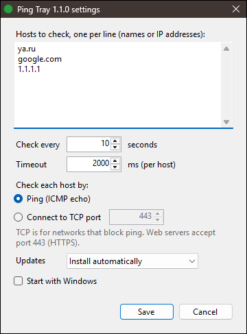

# Ping Tray

A small Windows tray app that shows whether the internet is reachable. It pings a few
hosts at a set interval (or connects to a TCP port of each, where ping is blocked) and
colors its icon in the notification area:

- green: every host answers;
- yellow: some hosts do not answer;
- red: no host answers;
- gray: not checked yet, or there are no hosts to check.

Hover over the icon to see the ping time of each host:

```text
2 of 3 hosts answer
× 192.0.2.1: timeout
ya.ru: 175 ms
google.com: 123 ms
```

Hosts that fail come first, marked ×, and say why: `timeout`, `DNS error`,
`DNS timeout`, `unreachable`, `refused` (TCP only), `TTL expired` or `failed`. The
others follow from the slowest to the fastest, so the best are at the bottom.

## Installing

Download `PingTray.exe` from the
[latest release](https://github.com/t7ko/windows-ping-tray/releases/latest), put it in
any folder you can write to, and run it. It is a single file and needs nothing else:
.NET Framework 4.8 is part of Windows 10 and 11, and the settings live in `%APPDATA%`.
The folder must be writable (so not `Program Files`) because Ping Tray updates itself in
place; during an update, `PingTray.exe.new` and `PingTray.exe.old` appear next to it for
a moment.

The exe is not signed, so the first start may show "Windows protected your PC": click
More info, then Run anyway. (Or before starting it: right-click the file, Properties,
tick Unblock.) Updates that Ping Tray downloads itself do not ask again.

Windows 11 puts new tray icons behind the ^ arrow. To keep the icon on the taskbar, drag
it out of there, or turn it on in Settings > Personalization > Taskbar > Other system
tray icons.

## Using it

- Hover over the icon: the ping time of each host.
- Click it: check all hosts now. The icon is gray until the answers are in, usually a
  blink; when hosts do not answer, up to the timeout.
- Double-click it: Settings.
- Right-click it: Check connection now, Settings, Check for updates, Home page (this
  page), Report a problem, Exit.

Settings has the hosts to check, one per line (host names or IP addresses; a pasted URL
such as `https://ya.ru/` is cut down to its host), how often to check them (1 to 3600
seconds; once a minute by default), how long to wait for each answer (100 to 10000 ms),
how to check them (ping, or a TCP connection to a port), what to do with updates, and
Start with Windows.



Each check tries every host once, all at the same time. The DNS lookup and the ping or
connection each get up to the timeout. Ping Tray prefers a host's IPv4 address, because
many connections have no working IPv6. It also checks 2 seconds after the network
changes, such as when Wi-Fi drops or a VPN connects, instead of waiting for the next
interval.

A tooltip holds at most 127 characters (a Windows limit). Hosts that do not fit are
counted in a last line, such as `+3 more`. Those are the fastest ones; failing hosts are
always listed.

The settings are stored in `%APPDATA%\PingTray\settings.ini`. Start with Windows adds the
value `PingTray` under `HKCU\Software\Microsoft\Windows\CurrentVersion\Run` with the
exe's current path; after moving the exe, turn it on again.

### Networks that block ping

Some networks (company firewalls, VPNs, guest Wi-Fi) drop ping, so the icon stays red
there even though web sites open. In Settings, choose Connect to TCP port instead. Ping
Tray then opens a TCP connection to that port of each host and closes it at once; the
time shown is that of the connection handshake, which is about the same as a ping. Port
443 (HTTPS) works for web sites and for `1.1.1.1` and `8.8.8.8`. A refused connection
counts as a failure, because a firewall may be the one refusing it. The tooltip's first
line then ends with the port, such as `Online (TCP 443)`.

### Updates

A minute after it starts, and then once a day, Ping Tray asks GitHub for the latest
release of this repository. What it does with a newer one depends on Settings > Updates:

- Install automatically (the default): it downloads the new `PingTray.exe`, checks it,
  puts it in place of the running one and restarts. A notification says so.
- Ask before installing: a notification offers the new version; click it, or the
  Install version item in the menu.
- Don't check: it asks GitHub only when you click Check for updates.

Before installing, Ping Tray checks that the download has the size and SHA-256 that
GitHub lists for the release and that it is Ping Tray of the announced version. If
anything fails, the running version stays and a notification says why.

## Reporting problems

Right-click the icon and choose Report a problem, or click the address at the bottom of
Settings. That opens a new mail to <ivan.t7ko@gmail.com> in your mail app, with the
version, the Windows version, the settings and the current tooltip already in it. Add
what happened and what you expected, and send it. Without a mail app, write to that
address directly and mention the version: it is in the title of the Settings window.

## Building

```powershell
powershell -ExecutionPolicy Bypass -File scripts\build.ps1
```

This builds the exe, runs the tests in `tests\Tests.cs` and then writes
`dist\PingTray.exe`. It uses the C# compiler that comes with .NET Framework 4.8, so
nothing has to be installed. Exit Ping Tray before building, or the exe cannot be
replaced.

## Releasing

Raise `AssemblyVersion` and `AssemblyFileVersion` in `src/Program.cs`, commit, and run
`scripts\release.ps1`. It builds, tags `v<version>`, pushes `main` and the tag, creates
the GitHub release and attaches `PingTray.exe`. It needs a fine-grained GitHub token
with Contents read and write on this repository, in a file that `github.tokenFile` in the
git-ignored `local.properties` names. `scripts\push.ps1` pushes `main` with the same
token, without a release.
